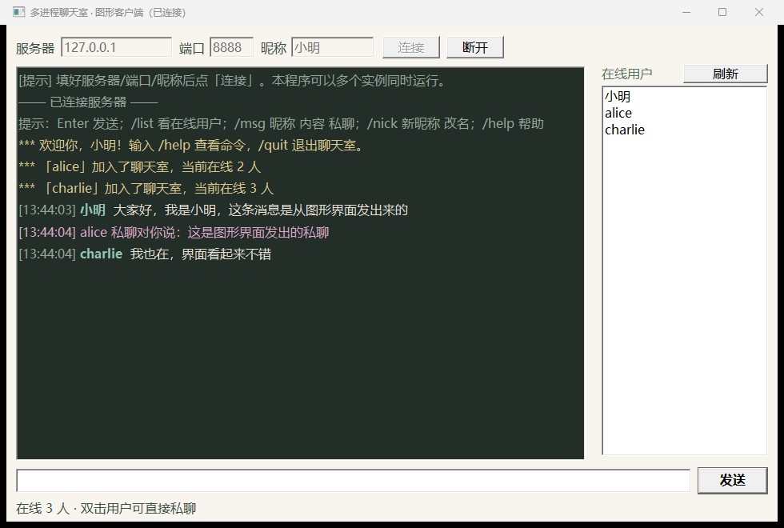

# 图形客户端（Windows）



一个**单文件 exe**，不需要装 Python、.NET 或任何运行库。开几个窗口就是几个客户端，
正好对应服务端"每来一个客户端 fork 一个子进程"的模型。

## 一、怎么用（三步）

1. **服务端先跑起来**（Linux / WSL / 云服务器）：

   ```sh
   cd chat && make
   ./build/server -p 8888 -d      # -d 打开实时看板，能看到子进程 PID
   ```

2. **双击 `chat_gui.exe`**（本目录已编译好一份）。

3. 填 **服务器 IP / 端口 / 昵称** → 点「连接」。

   服务器地址默认是 `0.0.0.0`（表示**本机**），端口默认 `8888`。
   连远程服务器时把它改成具体 IP，例如 `119.23.182.147`。
   连不上先检查：服务器是否已启动、**云服务器安全组是否放行 8888/TCP**。

## 二、界面说明

| 区域 | 说明 |
| --- | --- |
| 顶部 | 服务器地址、端口、昵称、连接 / 断开 |
| 左侧深色区 | 聊天记录，按类型上色：自己/他人的群聊（昵称绿色）、私聊（品红）、系统消息（金色）、错误（红色） |
| 右侧 | 在线用户列表，**有人上线/下线/改名会自动刷新**；双击某个用户会自动帮你填好 `/msg 昵称 ` |
| 底部 | 输入框 + 发送；**回车即发送** |
| 状态栏 | 连接状态、在线人数、操作提示 |

## 三、能输入的命令

| 输入 | 作用 |
| --- | --- |
| 直接打字 | 群聊，所有人可见 |
| `/list` 或 `/who` | 查看在线用户 |
| `/msg 昵称 内容`（或 `/w`） | 私聊 |
| `/nick 新昵称` | 改名（会广播给所有人） |
| `/clear` | 清屏 |
| `/help` | 帮助 |
| `/quit` | 退出 |

## 四、多开

- **直接双击多次** `chat_gui.exe` 就是多个客户端（每个窗口独立进程）；
- 或者用 `demo_3_clients.bat` 一次开 3 个并自动连接：

  ```bat
  demo_3_clients.bat                          :: 连 119.23.182.147:8888
  demo_3_clients.bat 192.168.1.10 8888        :: 连指定地址
  ```

  批处理里用的是英文昵称（避免 cmd 中文乱码），进窗口后输入 `/nick 小明` 就能改成中文名。

- 命令行参数（可组合，适合写脚本）：

  ```bat
  chat_gui.exe --server 119.23.182.147 --port 8888 --nick 小明 --auto-connect
  ```

## 五、自己编译

**Windows（推荐）**：双击 `build_windows.bat`，它会自动找 MinGW-w64 的 gcc 并生成 `chat_gui.exe`。
没装编译器的话，脚本里列了几个常见路径；也可以直接下载 MinGW-w64 安装包，安装时勾选 Add to PATH。

**Linux 交叉编译**（在服务器上生成 Windows exe）：

```sh
sudo apt install -y mingw-w64
bash build_linux_cross.sh
```

**手动命令行**：

```bat
gcc -O2 -Wall -Wextra -std=gnu99 -mwindows -o chat_gui.exe chat_gui.c ^
    -lws2_32 -lgdi32 -luser32 -lshell32 -static-libgcc
```

## 六、实现要点（答辩可讲）

- **技术栈**：纯 Win32 API + Winsock，没有第三方库。控件用 EDIT / LISTBOX / RichEdit。
- **多开**：每个进程一个客户端，没有全局互斥，所以天然支持多实例。
- **接收线程**：连接成功后起一个线程阻塞 `recv`，收到完整帧就 `PostMessage` 给 UI 线程，
  由 UI 线程更新界面——避免网络 IO 卡住窗口消息循环。
- **非阻塞连接**：`connect` 用非阻塞 + `select` 3 秒超时，连不上不会让窗口假死。
- **和文本客户端共存**：连接时 `LOGIN` 帧的载荷是 `昵称\tgui`。
  服务端子进程看到 `\tgui` 就切换成"下发结构化帧"（SAY / WHISPER / SYS / ERR / USERS），
  由客户端自己决定怎么渲染；命令行客户端不带这个标记，仍然收到服务端渲染好的带颜色文本。
  一套协议，两种渲染方式。
- **在线列表自动更新**：服务端在有人登录/退出/改名时，主动把最新的 USERS 帧推给所有 GUI 会话
  （命令行客户端不推，避免刷屏）。

## 七、常见问题

| 现象 | 原因 / 处理 |
| --- | --- |
| 点连接后提示连不上 | 服务端没启动 / 端口不对 / **安全组未放行** / IP 写错 |
| 提示"昵称已被占用" | 同一服务器上昵称不能重复，换一个即可 |
| 中文昵称显示正常吗 | 正常，收发都用 UTF-8 |
| 双击没反应 | 可能被杀毒软件拦截，加入信任即可（这是自己编译的 exe，源码就在旁边） |
| 想连本机测试 | 服务器填 `127.0.0.1`，端口和 `./build/server -p` 一致 |
